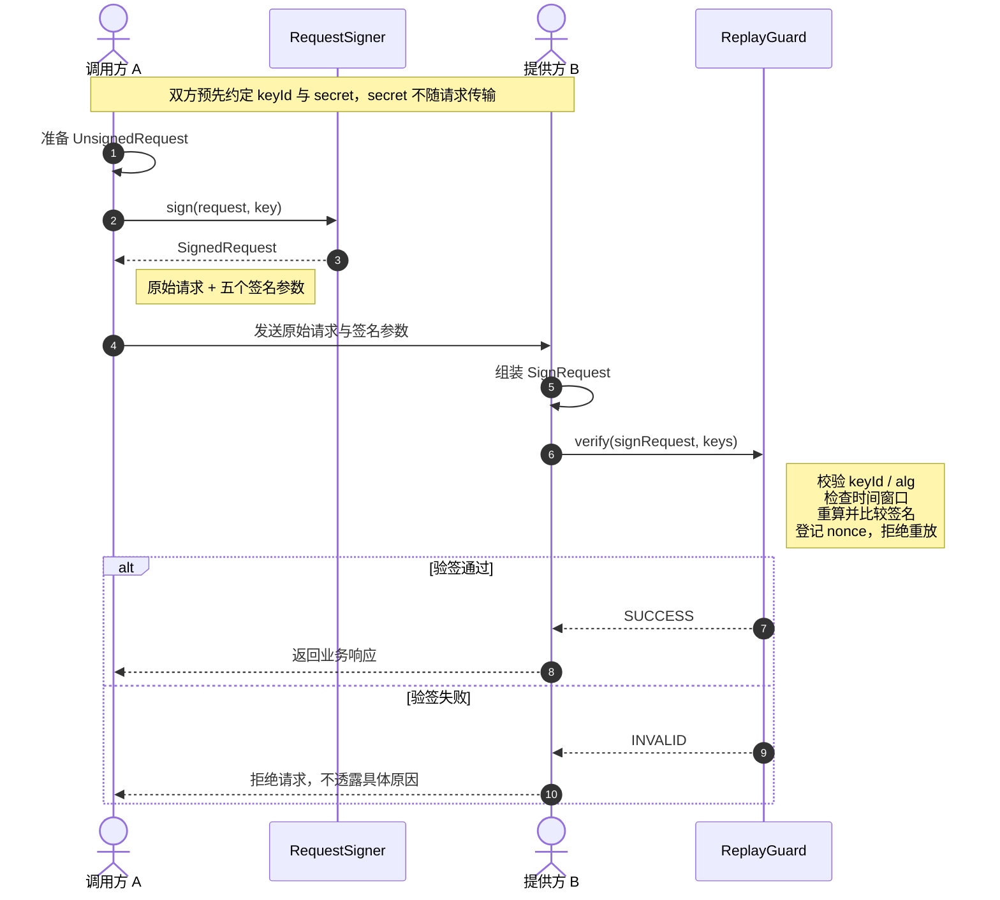

# crypto：签名与防重放

用于对外 OpenAPI 的请求签名、验签和防重放。属于 `banyan-commons`，只依赖 Java 17。

本文分为三部分：**调用方签名**、**提供方验签**、**共享协议**。

## 一、先用白话理解

假设系统 A 要调用系统 B：

- A 是**调用方**：给请求签名。
- B 是**提供方**：检查签名。
- 双方事先约定 `keyId` 和对应密钥 `secret`。密钥只用于计算签名，
  **不放进请求，也不通过网络发送**。

签名回答三个问题：

1. **是谁调用的？** 有正确密钥才能算出正确签名。
2. **请求有没有被改？** 方法、路径、查询参数和 body 都参与签名，
   改一个字符就会验签失败。
3. **是不是旧请求被重复发送？** 时间戳限制有效期，nonce 保证同一请求只能用一次。

签名**不是加密**：请求内容仍可被看到，生产环境仍应使用 HTTPS。

### 一次请求怎么走



## 二、调用方：给要发给第三方的请求签名

主入口是 **`RequestSigner`**。调用方只需提供业务请求，不需要先拼装协议字段：

```java
UnsignedRequest request = UnsignedRequest.of(
        "POST",
        "/openapi/orders",
        Map.of("page", List.of("1")),
        "{\"id\":1}");

RequestSigner signer = new RequestSigner();
SignedRequest signed = signer.sign(
        request,
        new SignKey("app1", "secret"));
```

`SignedRequest` 同时包含：

- `signed.request()`：原始请求数据
- `signed.authParams()`：需要附加到 HTTP 请求上的五个签名参数

| 参数 | 含义 |
|---|---|
| `alg` | 算法，当前为 `HmacSHA256` |
| `keyId` | 告诉对方该用哪把密钥 |
| `timestamp` | 请求时间，单位为毫秒 |
| `nonce` | 本次请求的随机串，每次不同 |
| `sign` | 最终签名 |

把 `authParams()` 放到 header 或 query 中都可以。这五个参数在规范化时会自动排除，
不会因为放进 query 就被重复计算。

`RequestSigner` **只准备数据，不发送 HTTP 请求**。拿到 `SignedRequest` 后，
使用自己的 `HttpClient`、Feign 或其他客户端发送即可。

如果只需要签名参数、不需要完整的 `SignedRequest`，也可以用
`Signs.sign(request, key)`。

## 三、提供方：验签并防止重放

把收到的 HTTP 请求组装为 `SignRequest`，再交给 `ReplayGuard`：

```java
ReplayGuard guard = new ReplayGuard(
        new HmacSha256SignAlgorithm(),
        new InMemoryNonceStore());

SignRequest request = new SignRequest(
        "POST",
        "/openapi/orders",
        Map.of("page", List.of("1")),
        body,
        Signs.parseTimestamp(headers.get("timestamp")),
        headers.get("nonce"),
        headers.get("keyId"),
        headers.get("alg"),
        headers.get("sign"));

VerifyResult result = guard.verify(
        request,
        Map.of("app1", new SignKey("app1", "secret")));

if (result != VerifyResult.SUCCESS) {
    // 拒绝请求。不要向调用方透露具体失败原因。
}
```

验签依次检查密钥与算法、时间窗口、签名和 nonce。
签名错误、请求过期、请求重放、未知 `keyId`，对外统一返回 `INVALID`。
只有请求本身格式不合法时才抛出 `IllegalArgumentException`。

默认时间窗口是 **5 分钟**，达到边界即视为过期。

## 四、密钥与可替换实现

### 多个应用与密钥轮换

直接构造 `SignKey`，用 `Map<String, SignKey>` 按 `keyId` 管理：

```java
Map<String, SignKey> keys = Map.of(
        "app1", new SignKey("app1", "old-secret"),
        "app1-v2", new SignKey("app1-v2", "new-secret"));
```

轮换期间可以暂时保留新旧两个 `keyId`，等调用方切换完成后再删除旧密钥。
库不会读取 Nacos、环境变量或 Spring 容器，密钥来源由应用自己决定。

### 需要时再替换两个接口

| 接口 | 默认实现 | 什么时候替换 |
|---|---|---|
| `SignAlgorithm` | `HmacSha256SignAlgorithm` | 需要使用另一套签名算法 |
| `NonceStore` | `InMemoryNonceStore` | 多实例部署、重启后仍需防重放 |

例如替换签名算法：

```java
RequestSigner signer = new RequestSigner(mySignAlgorithm);
ReplayGuard guard = new ReplayGuard(
        mySignAlgorithm,
        myNonceStore,
        clock,
        Duration.ofMinutes(5).toMillis());
```

## 五、多实例部署必须注意

`InMemoryNonceStore` 只保存当前 JVM 内存中的 nonce。
如果服务有多个实例，A 实例登记过的 nonce，B 实例并不知道，可能放过重放请求。

此时应实现自己的 `NonceStore`，例如用 Redis 的 `SET NX + TTL`：

```java
NonceStore store = (nonceKey, ttlMillis) ->
        redis.opsForValue()
                .setIfAbsent(nonceKey, "1", Duration.ofMillis(ttlMillis));

ReplayGuard guard = new ReplayGuard(
        new HmacSha256SignAlgorithm(),
        store);
```

这里只是接线示例，Redis 客户端由应用提供；本模块不会引入 Redis。

## 六、提供方接入 HTTP Filter

库只负责签名计算和验签，不绑定 Servlet、Spring MVC 或 WebFlux。
下面展示使用方如何组装，辅助方法由应用自己实现：

```java
public class OpenApiSignFilter implements Filter {

    private final ReplayGuard guard = new ReplayGuard(
            new HmacSha256SignAlgorithm(),
            new InMemoryNonceStore());

    private final Map<String, SignKey> keys = Map.of(
            "app1", new SignKey("app1", "secret"));

    @Override
    public void doFilter(ServletRequest req, ServletResponse resp, FilterChain chain)
            throws IOException, ServletException {
        HttpServletRequest request = (HttpServletRequest) req;
        String body = readBody(request);

        SignRequest signRequest = new SignRequest(
                request.getMethod(),
                request.getRequestURI(),
                toMultiMap(request.getParameterMap()),
                body,
                Signs.parseTimestamp(header(request, "timestamp")),
                header(request, "nonce"),
                header(request, "keyId"),
                header(request, "alg"),
                header(request, "sign"));

        if (guard.verify(signRequest, keys) != VerifyResult.SUCCESS) {
            ((HttpServletResponse) resp).sendError(401);
            return;
        }
        chain.doFilter(req, resp);
    }
}
```

注意：Servlet 请求的 body 通常只能读取一次。业务代码还要继续读取时，
请使用可重复读取的请求包装器。

## 七、共享协议：签名到底算了哪些内容

`Signs.canonicalize(request)` 按固定顺序生成待签名文本。规则一旦发布就不要随意修改，
否则调用方和提供方会算出不一致的签名。

| 顺序 | 内容 |
|---|---|
| 1 | 固定版本标记 `BANYAN-SIGN-V1` |
| 2 | HTTP method |
| 3 | 请求 path |
| 4 | 查询串：key 升序、同名值字典序、空值跳过、UTF-8 URL 编码一次 |
| 5 | `bodyHash`：body 的 SHA-256；没有 body 时按空串计算 |
| 6 | 毫秒时间戳 |
| 7 | nonce |
| 8 | keyId |
| 9 | alg |

`alg` / `keyId` / `timestamp` / `nonce` / `sign` 五个协议参数会从查询串中排除，
但其中的 `alg` / `keyId` / `timestamp` / `nonce` 仍作为独立字段参与签名。

调试签名不一致时，可以在双方分别打印各自的规范化结果做结构对比；
生产日志不要直接记录完整规范化串，以免带出敏感信息。

## 八、安全边界与当前限制

- `SignKey.toString()` 不显示 secret；`SignRequest.toString()` 不显示 body 和签名。
- 验签使用 `MessageDigest.isEqual` 做常量时间比较。
- commons 本身不写日志；应用记录失败原因时，也不要记录密钥、完整签名串或 body。
- 当前只有 HMAC-SHA256，不支持 MD5、国密和算法协商。
- 签名不加密内容；需要保密时请使用 HTTPS。
- 默认 nonce 存储只适合单实例，且过期项在下一次写入时才清理。
- 尚未签名的请求不能直接规范化：缺少时间戳、nonce、keyId 或算法时会抛出参数异常。
