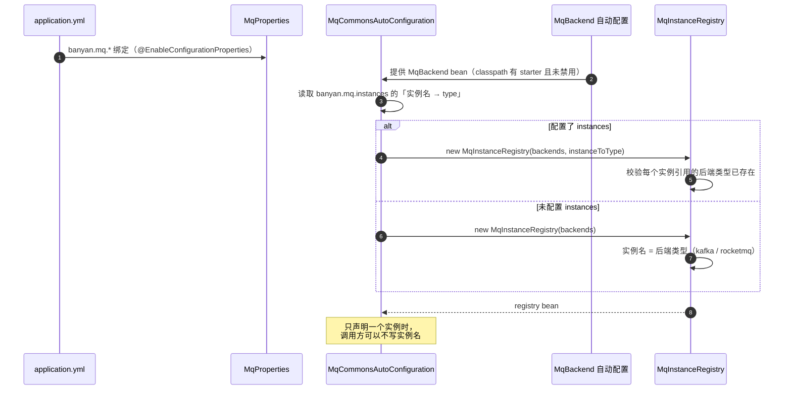
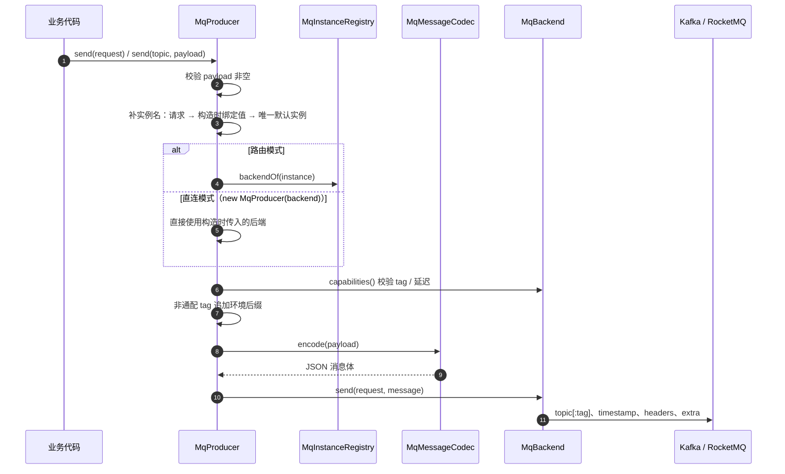
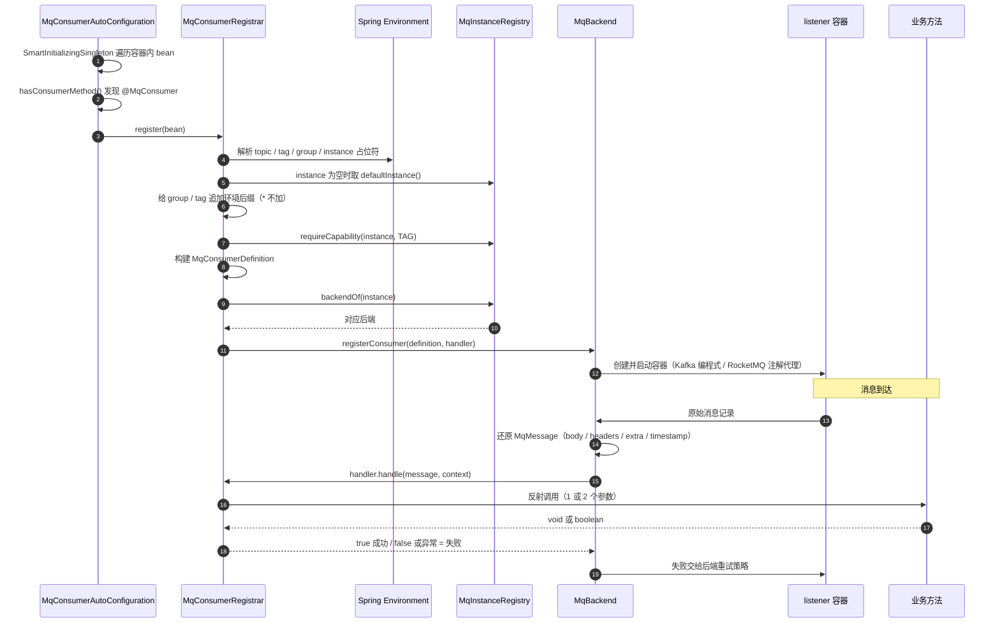

# banyan-mq

消息中间件抽象：业务只面向统一 API 发送与消费，底层 Kafka / RocketMQ 可切换；生产者与消费者可单独引入。

## 模块

| 模块 | 角色 | 依赖 |
|---|---|---|
| `banyan-mq-core` | 消息模型、发送/消费契约、逻辑实例、后端 SPI、能力声明 | `banyan-commons` |
| `banyan-mq-commons-spring` | Spring 层共享装配：统一配置、默认 JSON 编解码、逻辑实例路由 | `core` + `banyan-commons-spring` |
| `banyan-mq-producer` | 发送门面、事务提交后发送、延迟、实例路由 | `commons-spring` + `spring-context` / `spring-tx` |
| `banyan-mq-consumer` | `@MqConsumer`、一类多消费者、后缀隔离、重试语义 | `commons-spring` + `spring-context` |
| `banyan-mq-kafka-spring` | Kafka 后端 | `core` + `spring-kafka` |
| `banyan-mq-rocketmq-apache` | RocketMQ 后端 | `core` + `rocketmq-spring-boot-starter` |

依赖方向单向：`producer` / `consumer` 依赖 `commons-spring`，两个后端只依赖 `core`；后端之间互不依赖。引入 `producer` 或 `consumer` 会传递带入 `commons-spring`。

## 引入

只发消息：

```xml
<dependency>
    <groupId>cn.kennylee.banyan</groupId>
    <artifactId>banyan-mq-producer</artifactId>
    <version>0.1.0-SNAPSHOT</version>
</dependency>
<dependency>
    <groupId>cn.kennylee.banyan</groupId>
    <artifactId>banyan-mq-rocketmq-apache</artifactId>
    <version>0.1.0-SNAPSHOT</version>
</dependency>
```

只消费：把 `banyan-mq-producer` 换成 `banyan-mq-consumer`。两者都引也可以。

## 发送

日常只需要 topic 与 payload：

```java
producer.send("orders", "{\"id\":1}");
```

payload 是 `Object`，任意类型都可以：字符串、数字、布尔、POJO、`List<Bean>`、`Map<String, Bean>`、`Map<Bean, List<Bean>>`。默认用 Jackson 编码成 JSON，替换成别的 JSON 实现时注册一个 `MqMessageCodec` bean 即可。

带 tag、延迟、两者组合：

```java
producer.send("orders", "paid", "{\"id\":1}");
producer.send("orders", "{\"id\":1}", Duration.ofSeconds(30));
producer.send("orders", "paid", "{\"id\":1}", Duration.ofSeconds(30));
```

事务提交后发送：

```java
producer.sendAfterCommit("orders", "{\"id\":1}");
```

需要显式指定实例、key、headers、extra 或发送时间时，仍可用 `MqSendRequest`：

```java
producer.send(MqSendRequest.builder()
        .instance("rocketmq")
        .topic("orders")
        .tag("paid")
        .key("order-1")
        .headers(Map.of("tenant", "t1"))
        .extra(Map.of("traceId", "abc"))
        .payload(orderEvent)
        .timestamp(System.currentTimeMillis())
        .build());
```

- `extra` 与 `headers` 分开保存，消费端可分别读取，不会混在一起。
- `timestamp` 为空时使用发送时刻；它会作为消息属性透传给消费端。
- 默认给 `tag` 追加环境后缀（`paid-<profile>`），与消费者侧的 tag 后缀对齐；单条发送想关掉时设 `tagSuffixEnabled(false)`，全局关掉用 `banyan.mq.producer.tag-suffix-enabled: false`。

### 绑定实例

单后端项目不需要写实例名，自动使用唯一实例。多后端时可在启动阶段构造一个绑定实例的发送门面：

```java
@Bean
MqProducer orderProducer(MqInstanceRegistry registry) {
    return new MqProducer(registry, "rocketmq");
}
```

之后业务代码只写 `orderProducer.send("orders", body)`，不再关心实例名。

### 同类型多集群

`banyan.mq.instances.<name>.type` 只区分后端类型，区分不了「同类型的不同连接」。多个 Kafka 集群这类场景，直接给每个生产者绑定一个独立的 `MqBackend`：

```java
@Bean
MqBackend memberKafkaBackend(@Qualifier("memberKafkaTemplate") KafkaTemplate<String, String> template,
                             @Qualifier("memberKafkaConsumerFactory") ConsumerFactory<String, String> factory) {
    return new KafkaMqBackend(template, factory);
}

@Bean
MqProducer memberProducer(MqBackend memberKafkaBackend) {
    return new MqProducer(memberKafkaBackend);
}
```

消费者侧如需按实例名路由，显式声明实例名到后端的映射：

```java
@Bean
MqInstanceRegistry mqInstanceRegistry(MqBackend memberKafkaBackend, MqBackend paymentKafkaBackend) {
    return new MqInstanceRegistry(Map.of(
            "member-kafka", memberKafkaBackend,
            "payment-kafka", paymentKafkaBackend));
}
```

之后 `@MqConsumer(instance = "member-kafka")` 与 `new MqProducer(registry, "payment-kafka")` 都按这个映射路由。

只保证「本地事务提交后才发」，**不是** MQ 事务消息，不保证消息与数据库事务的原子性；事务回滚时不发送。

## 消费

```java
@Component
public class OrderConsumers {

    @MqConsumer(instance = "rocketmq", topic = "orders", tag = "paid")
    public boolean onPaid(MqMessage message) {
        // 返回 false 或抛异常 -> 触发重试；返回 true -> 成功
        return true;
    }

    @MqConsumer(instance = "rocketmq", topic = "orders", tag = "closed",
            group = "order-closed", concurrency = 4, maxRetryTimes = 5)
    public void onClosed(MqMessage message, MqConsumeContext context) {
        // context.getRetryTimes() / getMessageId() / getKey() / getNativeMessage()
    }

    @MqConsumer(topic = "${samples.topic}")
    public void onAny(MqMessage message) {
        // 不写 tag 时默认 tag = "*"，即不按 tag 过滤
        OrderEvent event = message.getData().toBean(OrderEvent.class);
    }
}
```

- 一个 class 里写多个方法即可，不需要为每个消费者建类。
- `tag` 是数组，默认 `{"*"}`：空数组或只有 `"*"` 时不追加后缀、也不向后端校验 TAG 能力；写了具体 tag 才按 tag 过滤。

### 一个 topic、多个 tag

支持两种用法，但**只有 RocketMQ 有 tag 能力**；Kafka 上写任何非 `*` 的 tag 都会在启动期失败。

**多个消费者方法各订阅一个 tag**：同一个 topic 上写多个方法即可，注册时会各自生成独立的消费定义。

```java
@MqConsumer(instance = "rocketmq", topic = "orders", tag = "paid", group = "order-paid")
public void onPaid(MqMessage message) { }

@MqConsumer(instance = "rocketmq", topic = "orders", tag = "closed", group = "order-closed")
public void onClosed(MqMessage message) { }
```

**一个方法订阅多个 tag**：`tag` 直接写数组，框架负责拼成后端的过滤表达式，调用方不需要知道分隔符：

```java
@MqConsumer(instance = "rocketmq", topic = "orders",
        tag = {"paid", "closed"},
        group = "order-status")
public void onStatusChanged(MqMessage message, MqConsumeContext context) {
    // context.getTag() 是消息的实际单个 tag，不是数组
}
```

注意事项：

- 一条消息只能有一个 tag（RocketMQ 限制），多 tag 是消费端订阅能力，不是发送端能力。
- 环境后缀会**逐个 tag** 追加：`{"paid", "closed"}` 在 UAT 下变成 `paid-uat || closed-uat`。
- 数组元素里不要写 `||` 分隔符，否则启动期直接报错；`"*"` 也不能与其它 tag 混用。
- 同一个 topic 上多个消费者如果手写 `group`，必须使用不同消费组；RocketMQ 同一消费组对同一 topic 的订阅会互相覆盖。不写 `group` 时框架按 `类名_方法名Consumer` 自动生成，天然不冲突。
- 后端不支持时启动期直接报错：单个 tag 校验 `TAG`，多个 tag 校验 `MULTI_TAG`；RocketMQ 两者都支持，Kafka 都不支持。
- `topic` / `tag` / `group` / `instance` 支持 Spring 占位符；`concurrency` / `maxRetryTimes` 是数值，注解上不能写占位符。
- `concurrency` 默认 `0`（后端默认）：Kafka 映射容器并发数，RocketMQ 同时设置 `consumeThreadNumber` 与 `consumeThreadMax`。
- `maxRetryTimes` 默认 `-1`（后端默认）：RocketMQ 映射 `maxReconsumeTimes`；Kafka 没有内建重试能力，该属性在 Kafka 上不生效并打印 WARN，需要重试时用手动 ACK 或自定义错误处理器。
- 消费组与每个 tag 自动追加 `-<profile>` 环境后缀，防止同一 RocketMQ 在测试与 UAT 串台；两者可分别用 `groupSuffixEnabled = false` / `tagSuffixEnabled = false` 关闭。
- 返回值支持 `void` 与 `boolean`：
  - `void` 正常结束 = 成功；`void` 抛异常 = 失败
  - `boolean` 返回 `true` = 成功；返回 `false` = 失败
  - 失败是否重试取决于后端能力：RocketMQ 抛异常转为 `RECONSUME_LATER`，Kafka 交给容器错误处理器重试；后端不支持重试时只记录失败
- 异常不会被吞掉。
- 第二个参数是不透明的消费上下文：公共字段直接可读，厂商专有信息通过 `nativeMessage()` 自行转换。

## 配置

```yaml
banyan:
  mq:
    enabled: true
    suffix: uat
    producer:
      enabled: true
      tag-suffix-enabled: true
    consumer:
      enabled: true
      suffix-enabled: true
    instances:
      orders:
        type: kafka
      notify:
        type: rocketmq
```

- `banyan.mq.suffix` 为空时使用首个激活 profile 作为环境后缀。
- 连接参数直接沿用 `spring.kafka.*` 与 `rocketmq.*`，本库不另造一套。
- 单后端项目不需要配置 `instances`：实例名默认等于后端类型。
- 多后端按逻辑实例名路由，不同业务走不同后端；**不做双写/广播，也不做运行时热切换**。
- 每个模块默认自动装配，可用 `banyan.mq.*.enabled` 关闭；classpath 缺少必需类时跳过并 WARN，应用不崩。

完整配置项（含后端原生配置与日志说明）见 [`CONFIGURATION.md`](CONFIGURATION.md)。

## 内部流程

### 配置如何变成逻辑实例



同类型多集群（例如两个 Kafka）无法用 `instances.<name>.type` 表达，改为在 Java 里 `new MqInstanceRegistry(Map<实例名, MqBackend>)`；自定义的 registry bean 会顶掉这里自动配置的那个。

### 生产者：配置 → 实例 → 发送



实例只在「发送前」解析一次：业务代码写的是实例名，`MqProducer` 拿它去 `MqInstanceRegistry` 换后端，再委托给具体后端发送。

### 消费者：注解 → listener



三步合起来：启动期把 yaml 与后端 bean 收敛成 `MqInstanceRegistry`；生产者拿实例名换后端发送；消费者按注解生成 `MqConsumerDefinition`，让同一个后端实现创建厂商容器，业务侧只剩方法。

## 能力差异

| 能力 | Kafka | RocketMQ |
|---|---|---|
| tag | 不支持 | 支持 |
| 延迟 | 不支持 | 支持（5 之前延迟级别，5 之后任意时间） |

使用后端不支持的能力时，在发送前或消费者注册时直接报错，不会静默忽略。

## 测试

不连真实 broker：用纯 JDK 假后端跑「发送 → 路由 → 编解码 → 分发」链路，后端模块只测自动装配、配置映射与能力声明。

## 已知限制

- 启动性能未优化：每个消费者一个容器/连接；用户已明确列为后续重构项，本期不作性能承诺。
- 原生能力逃生舱（`partition` / `attributes`）留待后续版本。
- 顺序消息、广播、手动 ACK、死信、批量、事务消息本期不做。
